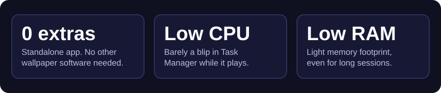

<p align="center">
  
</p>

<p align="center">
  <a href="../../releases/latest"></a>
  
  <a href="LICENSE"></a>
</p>

<p align="center">
  <b>Pick a folder of GIFs and they play as your desktop wallpaper.</b><br>
  No Python. No extra wallpaper app. Easy on your CPU and RAM.
</p>

<p align="center">
  <a href="../../releases/latest"></a>
</p>

---

<p align="center">
  
</p>

## Why GifWall?

I wanted animated wallpapers without the baggage. Most tools need a big separate app installed first and keep chewing resources in the background. GifWall is different:

- **Nothing else to install.** GifWall is the whole thing. No separate wallpaper engine or host app.
- **Very light on CPU and RAM.** It stays out of the way so your PC keeps its performance.
- **Gets out of your game's way.** It pauses automatically when a fullscreen app or game is running.

<!-- PREVIEW: uncomment after adding assets/demo.gif and assets/screenshot.png
## Preview

<p align="center">
  
</p>

<p align="center">
  
</p>
-->

## Download (no Python needed)

1. Go to the [Releases](../../releases/latest) page.
2. Download `GifWall_Setup.exe` (installer) or `gifwall.exe` (portable, just double-click).
3. Run it and select your GIF folder.

> **Windows SmartScreen / antivirus warning:** the app is not digitally signed, so Windows may show "Windows protected your PC". Click **More info → Run anyway**. Some antivirus tools also flag PyInstaller-built apps by mistake (false positive). The full source code is in this repository.

## Features

- Animated GIFs as your live desktop wallpaper
- Auto-change interval: 30 sec, 1 min, 5 min, 10 min, 30 min, 1 hour
- Random or sequential order
- System tray icon for quick control
- Auto-pause when a fullscreen app or game is running

## Build from source

```bat
git clone https://github.com/redoan2010/GifWall.git
cd GifWall
pip install -r requirements.txt
build.bat
```

The finished `gifwall.exe` appears in the `dist` folder.

## License

Released under the [MIT License](LICENSE).
